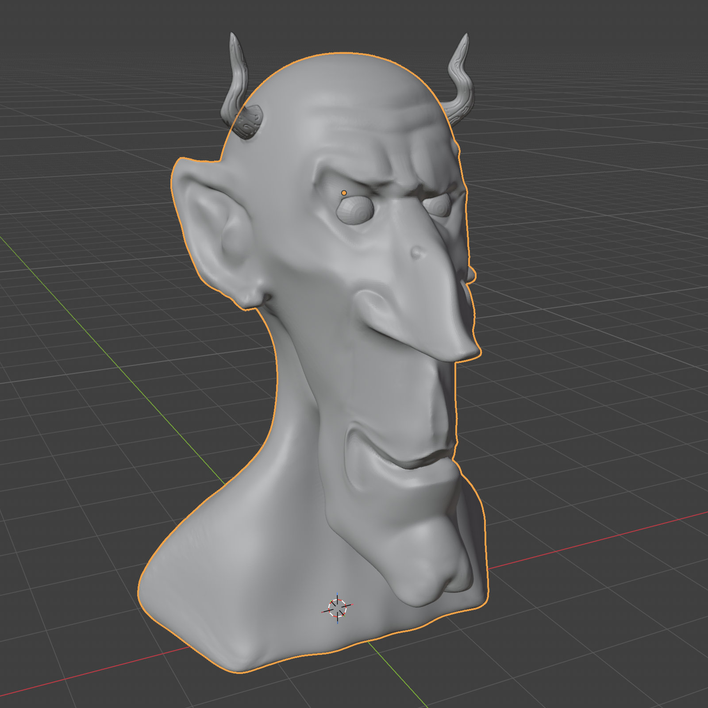
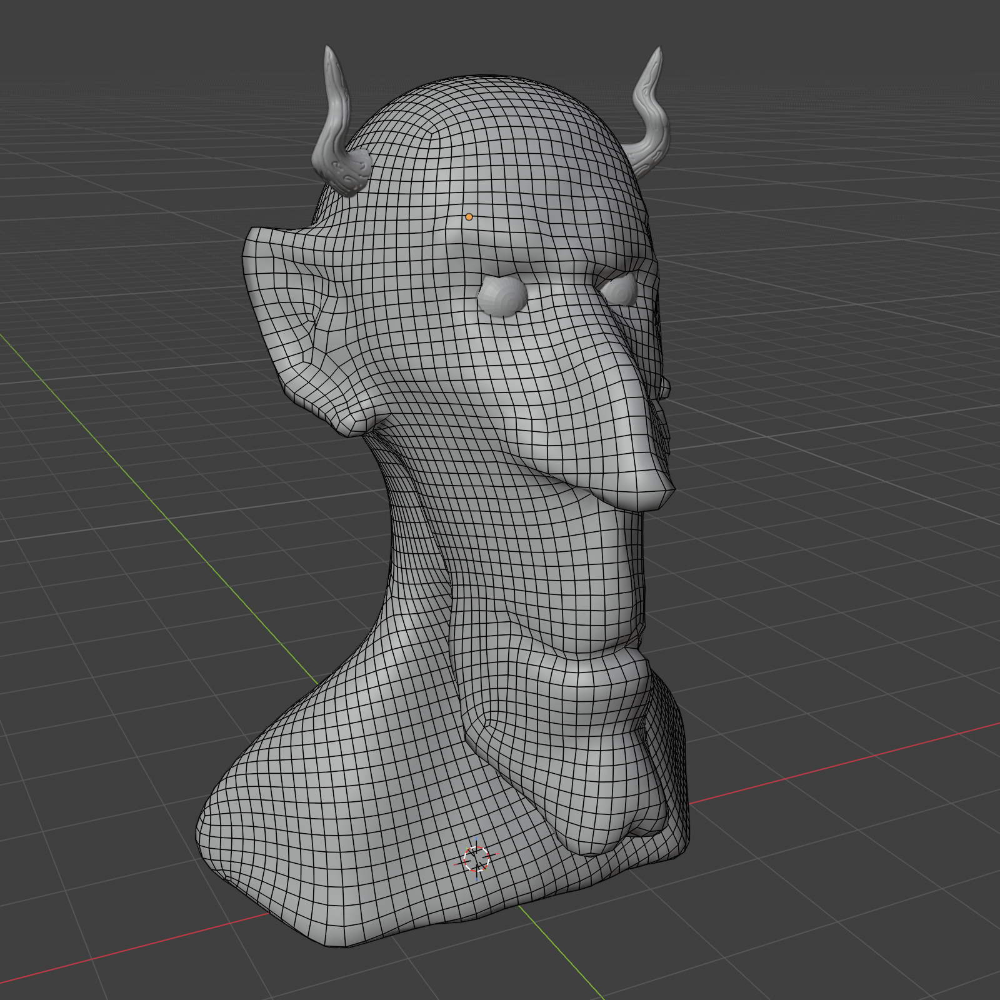
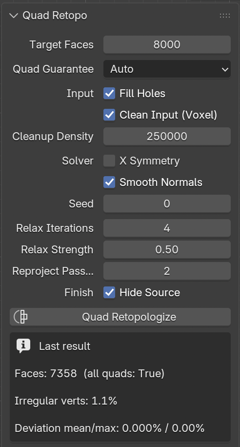

# blender-retopology

Utility for Blender 5.3 that automatically retopologizes a mesh into quads.

**Quad Retopo** is a Blender extension that turns a dense sculpt or scan into a
clean mesh made **only of quads**, with a face count you choose. It is tuned for
organic models such as bodies, heads and creatures. The source object is never
modified: the result is written to a new object named `<source>_retopo`.

Sculpt:



Retopology:



Menu:



## Install

1. Zip the `quad_retopo` folder (the zip must contain `quad_retopo/blender_manifest.toml`).
2. In Blender: **Edit → Preferences → Get Extensions → ⌄ → Install from Disk…** and pick the zip.
3. Open the **Retopo** tab in the 3D View sidebar (press `N`).

## Usage

1. In Object Mode, select the mesh you want to retopologize and make it active.
2. Set **Target Faces**, plus **X Symmetry** if the model is symmetric.
3. Click **Quad Retopologize**. Blender is busy until the run finishes. A
   3M-face sculpt takes about 20–35 s.

## How it works

```
source ─► copy (modifiers + transforms applied)
       ─► Fill Holes ─► voxel remesh (clean, closed, ~Cleanup Density faces)
       ─► QuadriFlow solve ─► join leftover triangles
       ─► [cut + mirror if X Symmetry] ─► [one Catmull-Clark step if needed]
       ─► Relax + reproject onto the source (× Reproject Passes)
       ─► validate (fails if any face is not a quad)
```

**How all-quads is guaranteed:** one Catmull-Clark subdivision step turns *any*
polygon mesh into pure quads, since each n-sided face becomes n quads. When the
solver output isn't already all quads, the mesh is solved at a quarter of the
target and subdivided once, which brings it back to roughly the target count.
A final check refuses to output a mesh that contains a non-quad.

## Options

### Main

| Option | Default | Meaning |
|---|---|---|
| **Target Faces** | 8000 | Approximate face count of the result. If the solver misses by more than 10%, the add-on re-solves once with a corrected request, so results usually land within ~15% of this value. Raise it to resolve small features: fingers, ears, or narrow gaps such as between the thighs. |
| **Quad Guarantee** | Auto | How the all-quad rule is enforced (see below). |

**Quad Guarantee** values:

- **Auto**: solve directly at Target Faces. If any triangle or n-gon survives,
  re-solve at ¼ of the target and apply one Catmull-Clark step. This gives the
  sharpest result for a given face count, because quads follow the field solver
  directly.
- **Always Subdivide**: always solve at ¼ of the target, then apply one
  Catmull-Clark step. Edge flow is a bit smoother and more even, but small
  details get only a quarter of the solver's resolution.

### Input

| Option | Default | Meaning |
|---|---|---|
| **Fill Holes** | On | Caps open boundaries (neck stumps, open feet, missing faces) before cleanup, so the result is a closed surface. Without it, a large hole voxelizes into a paper-thin double shell that the solver handles badly. It is skipped on closed meshes. On very dense open meshes it can add ~15 s. It can't fill holes bordered by non-manifold geometry, but the voxel step still closes small ones. |
| **Clean Input (Voxel)** | On | Voxel-remeshes a copy of the input before solving. This makes the mesh manifold and watertight with a single surface, removes self-intersections, and caps the density so the solver stays fast. Turn it off only if your mesh is already clean, manifold and of moderate density (≲ 500k faces). Otherwise the solver may refuse the mesh or be very slow. |
| **Cleanup Density** | 250000 | Approximate face count of the voxel-cleaned copy, which sets the voxel size (`√(surface area / value)`). The actual count is often somewhat higher. Lower values are faster but can fuse thin parts (fingers, ears) or close narrow gaps. Higher values keep finer detail but make the solver slower. Keep it far above Target Faces, at least 20×. Only used when Clean Input is on. |

### Solver

| Option | Default | Meaning |
|---|---|---|
| **X Symmetry** | Off | Makes the result exactly mirror-symmetric across the source object's **local X plane**, with identical topology and positions on both sides. The mesh is solved, cut at the plane, mirrored and welded, then subdivided once, so this option always uses the subdivide path whatever Quad Guarantee says. During relaxation, each vertex is averaged with its mirror twin. If the source is not quite symmetric, the result follows the average of both sides. The object's origin must lie on the symmetry plane. |
| **Smooth Normals** | On | Passed to QuadriFlow's *smooth normals* option. It currently has no visible effect, because the final result is always shaded smooth. |
| **Seed** | 0 | Random seed for QuadriFlow. Different seeds give different but equally valid layouts. Change it if a run puts an awkward pole or spiral somewhere important. |

### Finish

| Option | Default | Meaning |
|---|---|---|
| **Relax Iterations** | 4 | Number of smoothing steps per pass. Each step moves vertices toward the average of their neighbours, only along the surface, so quads become more even without the shape shrinking. 0 disables relaxing. |
| **Relax Strength** | 0.5 | How far each step moves a vertex toward that average (0 = not at all, 1 = all the way). High values with many iterations can blur small forms before reprojection pulls them back. |
| **Reproject Passes** | 2 | Number of *relax → snap back onto the source* rounds. Snapping casts rays along each vertex normal in both directions, up to 2× the mean edge length, which avoids sticking to the wrong limb. A vertex that misses goes to the nearest surface point. More passes give a slightly better fit and evenness at a small extra cost. |
| **Hide Source** | On | Hides the source object in the viewport after a successful run, so the result is visible on its own. |

### Last result

After a run, the panel shows a report for the active object. It is also stored
as the custom property `quad_retopo_report` (JSON) on the result.

- **Faces / all quads**: the final face count, and confirmation that every face is a quad.
- **Irregular verts**: share of vertices that don't have exactly 4 edges (poles).
  Lower usually means cleaner edge loops. Values around 1–2% are typical.
- **Deviation mean/max**: distance from the result's vertices to the source
  surface, as a percentage of the source's bounding-box diagonal.

The JSON also has timings per stage, the voxel size, whether the subdivide path
was used (`subdivided`), any calibration re-solve (`calibrated`), and, with X
Symmetry, `mirror_error` (0 means exactly symmetric).

## Python API

```python
import bpy
from quad_retopo import pipeline
from quad_retopo.pipeline import RetopoParams

obj, report = pipeline.run(
    bpy.data.objects["person"],
    RetopoParams(target_faces=8000, use_symmetry=True),
)
```

`RetopoParams` fields map 1:1 to the options above: `target_faces`,
`guarantee` (`'AUTO'` / `'SUBDIVIDE'`), `fill_holes`, `use_voxel_remesh`,
`voxel_faces`, `use_symmetry`, `smooth_normals`, `seed`, `relax_iterations`,
`relax_strength`, `reproject_passes`. When the add-on is installed as an
extension, the module is `bl_ext.<repo>.quad_retopo` instead of `quad_retopo`.

## Tests

The suite runs headless on generated shapes (a sphere, a torus with a hole
through it, and a cube missing one face), in Auto, Always Subdivide and X
Symmetry modes:

```bash
"/Applications/Blender 5.3.app/Contents/MacOS/Blender" -b --factory-startup --python tests/run_tests.py
```

To test objects from your own file instead:
`blender -b file.blend --python tests/run_tests.py -- ObjectName`.

## Building and releases

The extension zip is built with Blender's own packager:

```bash
mkdir -p dist
"/Applications/Blender 5.3.app/Contents/MacOS/Blender" --command extension build --source-dir quad_retopo --output-dir dist
```

On GitHub, [.github/workflows/build.yml](.github/workflows/build.yml) does this
automatically. Every push to `main` and every pull request downloads Blender
(cached between runs), validates the manifest, runs the headless tests, and
builds the zip. The extension is attached to the run as an artifact named after
the package (e.g. `quad_retopo-0.1.0`). Downloading it gives
`quad_retopo-0.1.0.zip`, which can be installed directly with *Install from
Disk…*.

To publish a release, bump `version` in `quad_retopo/blender_manifest.toml`,
commit, then push a matching tag:

```bash
git tag v0.2.0 && git push origin v0.2.0
```

The workflow then creates a GitHub Release with the zip attached. It fails if
the tag and the manifest version differ. To catch that before pushing, enable
the repo's pre-push hook once per clone:

```bash
git config core.hooksPath .githooks
```

It refuses to push a `v*` tag that doesn't match `version` in the manifest at
the tagged commit. To test against another Blender
version, change `BLENDER_VERSION` in the workflow.

## Limitations

- Blender is busy until the run finishes. There is no background mode yet.
- Features narrower than about one quad, such as gaps between fingers or legs
  that nearly touch, get bridged over. Raise Target Faces to resolve them.
- QuadriFlow does not follow sharp creases, so this is meant for organic
  shapes, not hard-surface models.
- UVs, vertex colors and other attributes are not transferred to the result.
